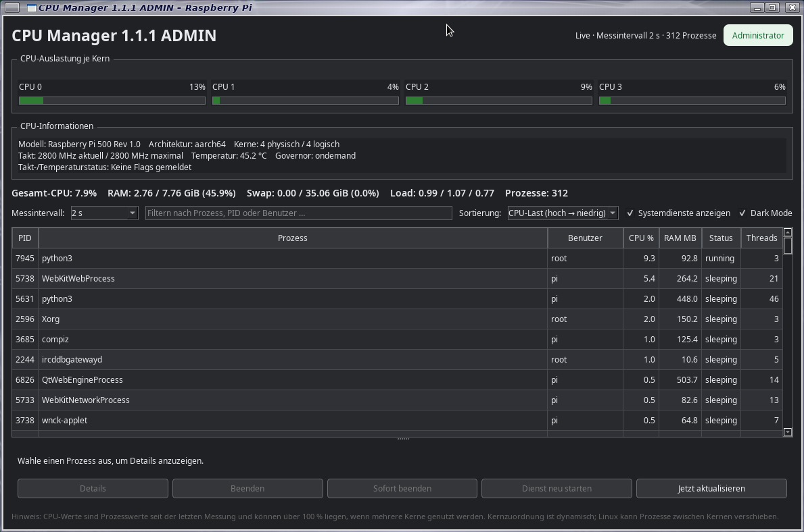

# CPU Manager 1.1.1 ADMIN

CPU Manager ist ein grafischer Systemmonitor für Raspberry Pi und andere Debian-/Linux-Systeme. Er zeigt die Auslastung der CPU-Kerne, Arbeitsspeicher und laufende Prozesse an. Für Verwaltungsaktionen wird eine grafische Administratorfreigabe über PolicyKit verwendet.



[Github Seite](https://github.com/Angonikro/CPU-Manager/)

> **Projektversion:** 1.1.1  
> **Paketname:** `cpu-manager_1.1.1_all.deb`  
> **Oberfläche:** PySide6 / Qt Widgets (ohne Qt WebEngine)

## Funktionen

- Live-Anzeige der Gesamt-CPU-Auslastung und der einzelnen CPU-Kerne
- Übersicht zu RAM, Swap und Load Average (1, 5 und 15 Minuten)
- Prozessliste mit PID, Name, Benutzer, CPU- und RAM-Verbrauch, Status und Thread-Anzahl
- Prozesse filtern und nach CPU, RAM, PID oder Name sortieren
- Option **„Systemdienste anzeigen“** zum Ein- und Ausblenden erkannter Systemdienste und Hintergrundprozesse
- CPU-Informationen wie Modell, Architektur, Kernanzahl, Takt, Temperatur und Governor, soweit das System diese Daten bereitstellt
- Einstellbares Messintervall: **1, 2, 5, 10 oder 30 Sekunden**
- Gespeicherte Einstellungen für Messintervall, Hell-/Dunkelmodus und Anzeige der Systemdienste
- Prozessdetails einschließlich Programmdatei, Kommandozeile und erlaubter CPU-Affinität
- Verwaltungsaktionen wie Prozess beenden und – sofern eindeutig zuordenbar – einen systemd-Dienst neu starten
- Start über das Anwendungsmenü ohne zusätzliches Terminal; Administratorfreigabe über PolicyKit

## Voraussetzungen

- Raspberry Pi OS oder ein Debian-basiertes Linux mit grafischer Desktop-Sitzung
- Python 3
- PySide6 Qt Widgets (`python3-pyside6.qtwidgets`)
- psutil (`python3-psutil`)
- PolicyKit (`pkexec`) für den ADMIN-Start
- Ein aktiver PolicyKit-Agent in der Desktop-Sitzung

Eine virtuelle Python-Umgebung und `pip` sind für die Debian-Installation nicht erforderlich.

## Installation (empfohlen): Debian-Paket

Lade `cpu-manager_1.1.1_all.deb` aus den Release-Dateien herunter und installiere es im Verzeichnis, in dem die Datei liegt:

```bash
sudo apt install ./cpu-manager_1.1.1_all.deb
```

Danach kannst du **CPU Manager** über das Anwendungsmenü starten. Der Menüeintrag öffnet kein zusätzliches Terminal. Für Verwaltungsaktionen fragt PolicyKit bei Bedarf nach einer Berechtigung.

## Start aus dem GitHub-Quellcode

Entpacke das GitHub-ZIP. Es entsteht der Ordner `cpu-manager`. Öffne ein Terminal in diesem Ordner und installiere die benötigten Systempakete:

```bash
chmod +x install_dependencies.sh start_cpu_manager.sh launch_admin.sh
./install_dependencies.sh
```

Die Abhängigkeiten werden über `apt` installiert; das Skript richtet keine virtuelle Umgebung ein und verwendet kein `pip`.

Der Quellcode kann ohne Administratorrechte gestartet werden:

```bash
/usr/bin/python3 main.py
```

Für die normale Installation mit Administratorfreigabe verwende das Debian-Paket. Der enthaltene `launch_admin.sh`-Launcher ist für den installierten Programmpfad vorgesehen.

## Einstellungen und Systemdienste

Die Anwendung merkt sich deine Auswahl für den Hell-/Dunkelmodus, das Messintervall und die Checkbox **„Systemdienste anzeigen“**. Diese Einstellungen werden beim nächsten Start wiederhergestellt.

Wenn **„Systemdienste anzeigen“** ausgeschaltet ist, blendet CPU Manager erkannte systemd-Dienste und bekannte Hintergrundprozesse in der Prozessliste aus. Die Gesamtwerte für CPU und Arbeitsspeicher beziehen sich weiterhin auf das gesamte System. Die genaue Erkennung kann je nach Linux-Distribution und Prozess-Cgroup variieren.

## Hinweise zur Bedienung

- Ein Prozess kann mehr als 100 % CPU anzeigen, wenn er mehrere Kerne gleichzeitig nutzt.
- Linux kann Prozesse zwischen CPU-Kernen verschieben. Die angezeigte CPU-Affinität zeigt, auf welchen Kernen ein Prozess laufen darf, nicht auf welchem Kern er dauerhaft läuft.
- **Beenden** sendet ein normales Beendigungssignal. **Sofort beenden** kann ungespeicherte Daten verlieren lassen.
- Das Neustarten eines Dienstes kann davon abhängige Programme kurz unterbrechen. Prüfe die Auswahl vor der Bestätigung.
- Einige Hardwarewerte, etwa Temperatur, Governor oder Drosselungsstatus, sind nicht auf jedem Gerät verfügbar.

## Fehlerbehebung

**Das Programm startet nach der Installation nicht:**

- Stelle sicher, dass du eine grafische Desktop-Sitzung verwendest.
- Prüfe, ob ein PolicyKit-Agent läuft.
- Installiere fehlende Paketabhängigkeiten erneut:

  ```bash
  sudo apt update
  sudo apt install python3 python3-pyside6.qtwidgets python3-psutil pkexec
  ```

**Nach der Administratorabfrage erscheint kein Fenster:**

Prüfe das Protokoll unter `~/.cache/cpu-manager-admin.log`. Darin können Hinweise zum Start des erhöhten Qt-Prozesses stehen.

**Ein Paketname wird nicht gefunden:**

```bash
apt-cache search pyside6
```

## Projektdateien

- `main.py` – Programmeinstieg
- `cpu_manager/` – Oberfläche, Überwachung und Verwaltungsaktionen
- `install_dependencies.sh` – Installation der Systemabhängigkeiten
- `start_cpu_manager.sh` – Startskript
- `launch_admin.sh` – PolicyKit-Launcher für die installierte Anwendung
- `CHANGELOG.md` – Versionshistorie
- `RELEASE_NOTES_v1.1.1.md` – Hinweise zum Release 1.1.1
- `LICENSE` – Lizenzinformationen

## Lizenz

Siehe [`LICENSE`](LICENSE).

73 de DO2QG Andreas
